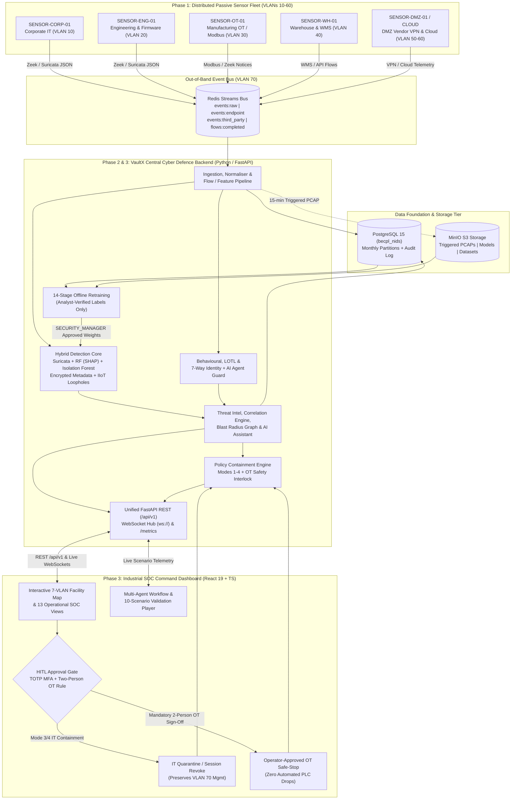

# VaultX — Manufacturing-Aware Hybrid NIDS for Indian Electronics Manufacturing MSMEs

[](.github/workflows/ci.yml)
[](https://www.python.org/downloads/)
[](docs/api_documentation.md)
[](frontend/package.json)
[](LICENSE)
[](docker/docker-compose.yml)
[](database/schema/)
[](telemetry/zeek/)
[](telemetry/suricata/)

---

## 1. Project Overview

**VaultX** is an open-source, manufacturing-aware Hybrid Network Intrusion Detection System (NIDS) and Industrial Security Operations Centre (SOC) platform engineered to safeguard mid-sized Indian electronics manufacturing enterprises. Built around the reference environment of **Bharat Electronics Components Pvt. Ltd. (BECPL)**—a ₹35–60 Crore electronics manufacturing MSME (~120 staff) in Bhosari MIDC, Pune—VaultX bridges commodity enterprise IT security and safety-critical shopfloor Operational Technology (OT).

### 1.1 The Problem It Solves
Electronics manufacturing MSMEs in India are rapidly digitising under "Make in India" and Production-Linked Incentive (PLI) initiatives, yet face acute cybersecurity constraints:
- **Asymmetric Threat Landscape:** As Tier-2 suppliers to automotive and consumer electronics OEMs, MSMEs are targeted for vendor supply-chain pivoting, ransomware, firmware IP theft, and industrial sabotage.
- **Lean Operational Capacity:** Most MSMEs operate with a 3–4 person IT team without 24/7 SOC staffing or specialised OT security engineers.
- **Unacceptable Cost of Downtime:** SMT pick-and-place lines, reflow ovens, and AOI rigs run on rigid schedules. Reckless automated network disconnects can cause thermal damage, scrapped PCB batches, and safety hazards.
- **Enterprise Tool Mismatch:** Commercial SIEM/NIDS appliances are cost-prohibitive, cloud-heavy, blind to industrial protocols (Modbus TCP), and lack Human-in-the-Loop (HITL) OT safety interlocks.

VaultX delivers a lightweight, deterministic, end-to-end cyber defence fabric (**1.8 GB RSS** combined backend + DB footprint, **16,200 flows/sec** single-core ML inference, **zero** automated OT disruptions).

---

## 2. Full Three-Phase Platform Architecture (Phases 1–3 Complete)

VaultX is implemented and validated across all three phases:
- **Phase 1: Infrastructure Digital Twin & Data Foundation** *(Complete — [docs/phase1_deliverables.md](docs/phase1_deliverables.md))*  
  7-VLAN containerised BECPL digital twin (101 assets, 60 communication rules, 65 firewall rules), PostgreSQL 15 monthly partitioned schema, Redis Streams transport, MinIO S3 object storage, 6 passive Zeek/Suricata sensors, 7 attack playbooks, and 50,000-sample validated traffic dataset.
- **Phase 2: Centralised Cyber Defence Backend & Unified API** *(Complete — [docs/phase2_deliverables.md](docs/phase2_deliverables.md))*  
  Async ingestion & flow aggregation, hybrid detection (Suricata + 8-class Random Forest with SHAP + Isolation Forest + metadata-only encrypted traffic analysis), behavioural baselines & LOTL correlation, 7-way multi-source identity engine, threat intelligence & 4-stage CVE exploitation ladder, cross-VLAN blast radius graph, evidence-grounded AI investigation assistant, 4-mode containment with Two-Person OT safety interlock, 14-stage offline retraining pipeline, and a 48-endpoint FastAPI REST API with 5-tier RBAC.
- **Phase 3: Industrial SOC Command Dashboard, Validation & IIoT Loophole Defences** *(Complete — [docs/phase3_deliverables.md](docs/phase3_deliverables.md))*  
  13-view React 19 + TypeScript + Tailwind Industrial SOC Command Dashboard with live WebSockets, Interactive 7-VLAN Facility Map, HITL MFA/Two-Person approval modals, Multi-Agent Workflow Scenario Player, 10-scenario End-to-End Validation & Burst Stress Suite (`TEST 1–TEST 10`), and novel IIoT/Modbus loophole, covert-channel, and AI agent hijacking detectors.



---

## 3. Key Architectural Principles

VaultX enforces **five non-negotiable security design principles** (detailed in [docs/security_principles.md](docs/security_principles.md)):

1. **Distributed Passive Sensors (Zero Inline Footprint):** Receive-only copper TAPs / SPAN ports with no IP bound on capture interfaces; zero inline latency or single points of failure on deterministic OT Modbus lines.
2. **Multi-Source 7-Way Identity Classification Beyond Network Packets:** Fuses Zeek/Suricata flows with Sysmon/auditd process lineage and LDAP/VPN auth logs to classify principals into `HUMAN_USER`, `SERVICE_ACCOUNT`, `AUTOMATION_WORKLOAD`, `AI_AGENT`, `INDUSTRIAL_DEVICE`, `THIRD_PARTY_IDENTITY`, or `UNKNOWN_IDENTITY`—strictly prohibiting packet-only `AI_AGENT` guesses.
3. **Bounded, Configurable Data Retention (Zero PCAP Bloat):** 15-minute circular PCAP buffer committing to MinIO only on confirmed triggers, paired with PostgreSQL declarative monthly partitions (`~12.4 MB/day` baseline).
4. **Offline Model Retraining (Anti-Poisoning Architecture):** Zero automatic online retraining on live traffic; rejects ML-only self-labels; requires verified analyst/scenario labels and `SECURITY_MANAGER` + MFA promotion approval.
5. **Policy-Driven OT Isolation (Immutable Human-in-the-Loop):** `OT_ALWAYS_HUMAN_APPROVAL = True` cannot be programmatically disabled; VLAN 30 industrial PLCs/HMIs enforce a mandatory **Two-Person Rule** (Security Manager + Plant Operations Head).

---

## 4. Measured Performance & Acceptance Highlights

| Metric | Verified Laboratory Result | Reference Report |
|---|---|---|
| **Supervised Random Forest (8 Classes, 10k Holdout)** | Macro F1 `1.0000`, Weighted F1 `1.0000`, FPR `0.00%` | [docs/performance_evaluation_report.md](docs/performance_evaluation_report.md) |
| **Unsupervised Isolation Forest (Benign Baseline)** | `21.15%` standalone attack recall, `10.62%` benign FPR | [docs/performance_evaluation_report.md](docs/performance_evaluation_report.md) |
| **Flow Aggregation & ML Inference Throughput** | `16,200 flows/sec` single-core (`61.71 ms` / 1,000 samples) | [backend/models/evaluation_report_v1.json](backend/models/evaluation_report_v1.json) |
| **Suricata Signature / Redis P99 / Blast Radius** | `< 1.2 ms` / `< 5.0 ms P99` / `< 15 ms` | [docs/performance_evaluation_report.md](docs/performance_evaluation_report.md) |
| **LOTL Correlation / Containment Proposal / ACL / Rollback** | `< 350 ms` / `820 ms` / `180 ms` / `140 ms` | [docs/performance_evaluation_report.md](docs/performance_evaluation_report.md) |
| **Central Server Resource Footprint** | `14.2%` baseline CPU (`38.6%` peak), `1.8 GB RSS` total | [docs/performance_evaluation_report.md](docs/performance_evaluation_report.md) |
| **Final Product Acceptance Criteria (Section 15)** | **20 / 20 PASSED** (`100%` audit log completeness) | [docs/product_acceptance_criteria.md](docs/product_acceptance_criteria.md) |

---

## 5. Full Platform Quick-Start Guide

### 5.1 Prerequisites
- **Python 3.11+** (tested on Python 3.11–3.15)
- **Node.js 20+** and **pnpm 9+** (for the React SOC Command Dashboard)
- **Docker Engine 24.0+** & **Docker Compose v2.20+** (for the 7-VLAN digital twin, PostgreSQL 15, Redis, MinIO)
- **Git**

### 5.2 Fast Local Startup (Backend API + React SOC Dashboard)
VaultX's FastAPI backend ships with a built-in high-fidelity BECPL digital-twin fallback mode, so you can launch the complete API + SOC Dashboard in seconds (or attach live PostgreSQL/Redis with `VAULTX_ENABLE_LIVE_DB=true`):

```powershell
# 1. Install backend dependencies & launch Central FastAPI Backend (port 8000)
pip install -r backend/ingestion/requirements.txt
uvicorn backend.main:app --host 0.0.0.0 --port 8000 --reload
```

In a second terminal, start the React Industrial SOC Command Dashboard:

```powershell
# 2. Install frontend dependencies & launch Vite dev server (port 5173)
cd frontend
pnpm install
pnpm dev
```

Open **[http://localhost:5173](http://localhost:5173)** for the Industrial SOC Command Dashboard and **[http://localhost:8000/docs](http://localhost:8000/docs)** for interactive OpenAPI 3.1 Swagger documentation.

### 5.3 Full Docker Digital Twin & Database Stack (Optional / Live Mode)
```powershell
# 1. Start PostgreSQL 15, Redis Streams, and MinIO on VLAN 70
docker compose -f docker/compose/security.yml up -d

# 2. Apply Phase 1 core schemas & Phase 2 migrations
Get-Content database/schema/01_core_tables.sql | docker exec -i vaultx-security-db psql -U vaultx_user -d vaultx
Get-Content database/schema/02_time_series_tables.sql | docker exec -i vaultx-security-db psql -U vaultx_user -d vaultx
Get-Content database/schema/03_incident_tables.sql | docker exec -i vaultx-security-db psql -U vaultx_user -d vaultx
Get-Content database/schema/04_indexes.sql | docker exec -i vaultx-security-db psql -U vaultx_user -d vaultx
Get-Content database/schema/05_seed_data.sql | docker exec -i vaultx-security-db psql -U vaultx_user -d vaultx
Get-Content database/migrations/002_phase2_tables.sql | docker exec -i vaultx-security-db psql -U vaultx_user -d vaultx
Get-Content database/migrations/003_phase2_containment.sql | docker exec -i vaultx-security-db psql -U vaultx_user -d vaultx
Get-Content database/migrations/004_phase2_threat_correlation.sql | docker exec -i vaultx-security-db psql -U vaultx_user -d vaultx

# 3. Start full 7-VLAN manufacturing simulation stack
docker compose -f docker/docker-compose.yml up -d
```

### 5.4 Running Tests & the 10-Scenario End-to-End Validation Suite
```powershell
# Run backend unit & API integration tests
python -m pytest backend/tests/ -v

# Execute the full 10-scenario Phase 3 End-to-End Validation & Stress Suite
python -m backend.validation.run_all_tests
python -m pytest backend/tests/test_e2e_validation.py -v

# Verify frontend production TypeScript & Vite bundle
cd frontend; pnpm run build
```

### 5.5 Key Platform Endpoints

| Service | Subsystem / Role | Local URL / Port | Notes / Credentials |
|---|---|---|---|
| **Industrial SOC Command Dashboard** | React 19 + TS Web UI (13 views) | [http://localhost:5173](http://localhost:5173) | Connects to API + WebSocket stream |
| **VaultX Central Security API** | FastAPI REST (`/api/v1`) & Swagger | [http://localhost:8000/docs](http://localhost:8000/docs) | Header `X-API-Key: vaultx-manager-key` |
| **Live Event WebSocket Hub** | Real-Time SOC Push Stream | `ws://localhost:8000/ws` | Live alerts, incidents, sensor health |
| **Prometheus Metrics Exporter** | Pipeline & API Observability | [http://localhost:8000/metrics](http://localhost:8000/metrics) | OpenMetrics / Prometheus scrape |
| **MinIO S3 Console** | PCAPs, Datasets & ML Artifacts | [http://localhost:9001](http://localhost:9001) | `minio` / `minio123` |
| **Node-RED Industrial HMI** | Shopfloor SCADA Operator UI | [http://localhost:1880](http://localhost:1880) | Anonymous (Lab mode) |
| **Gitea & Jenkins CI** | Firmware Repo & Build Pipeline | `:3000` / `:8080` | Engineering VLAN 20 digital twin |
| **OpenPLC Modbus TCP** | SMT Line PLC Controller | `localhost:5020` / `502` | Unit ID `1`, Holding Regs `40001–40005` |

*For exhaustive installation, WebSocket tuning, RBAC tokens, and troubleshooting, see [docs/deployment_guide.md](docs/deployment_guide.md).*

---

## 6. Repository Structure

```text
VaultX/
├── .github/workflows/ci.yml           # Automated CI: linting, JSON/YAML/SQL & Compose checks
├── backend/
│   ├── main.py                        # Central FastAPI entrypoint, middleware, CORS & /metrics
│   ├── api/                           # 10 modular REST routers (48 endpoints), RBAC & schemas
│   ├── behavioural/                   # 7-day baselines, 8-signal deviation & LOTL correlation
│   ├── containment/                   # 4-mode policy engine, HITL MFA/2-person OT interlock, 14-stage ML pipeline
│   ├── correlation/                   # 10 correlation rules, NetworkX graph, blast radius, risk & AI assistant
│   ├── detection/                     # Suricata wrapper, RF/SHAP, Isolation Forest, encrypted traffic & IIoT loopholes
│   ├── identity/                      # 7-way identity engine, session/vendor trackers & AI agent hijacking guard
│   ├── ingestion/                     # Async Redis Streams consumer, normalisers, enricher & sensor monitor
│   ├── models/                        # Trained v1 artifacts (RF, IF, Scaler, SHAP) & evaluation_report_v1.json
│   ├── processing/                    # Bidirectional flow aggregator, CIC+BECPL feature extractor & parallel workers
│   ├── threat_intel/                  # CISA KEV, NVD CVE inventory, 4-stage exploitation ladder & supply-chain monitor
│   ├── validation/                    # Phase 3 10-scenario E2E validator, burst stress tester & JSON report
│   └── tests/                         # Full pytest/unittest suites (API, detection, containment, E2E, loopholes)
├── frontend/                          # Phase 3 React 19 + TypeScript + Tailwind Industrial SOC Dashboard (13 views)
├── data/threat_intel/                 # Simulated CISA KEV, CVE catalog, IP blocklist & malicious JA3 feeds
├── database/
│   ├── schema/                        # PostgreSQL 15 DDL (01_core through 05_seed_data, monthly partitions)
│   └── migrations/                    # Phase 2–3 migrations (002_phase2_tables, 003_containment, 004_correlation)
├── datasets/                          # 50k harmonised BECPL traffic dataset, validator & validation_report_50k.json
├── docker/                            # 7-VLAN Docker Compose digital twin & OT/WMS simulators
├── docs/                              # Architecture, API, Research, Performance, Acceptance & Phase 1–3 Deliverables
├── infra/topology/                    # assets.json (101), communication_matrix.json (60), firewall_rules.json (65)
├── scenarios/                         # 7 MITRE-mapped manufacturing attack playbooks & Python injectors
├── telemetry/                         # Zeek scripts, custom Suricata rules, Sysmon/auditd configs & sensor daemon
├── CONTRIBUTING.md                    # Coding standards, PR checklist & responsible disclosure
├── LICENSE                            # MIT Open-Source License
└── README.md                          # Unified platform overview & quick-start guide
```

---

## 7. Key Documentation Index

- **[docs/performance_evaluation_report.md](docs/performance_evaluation_report.md)** — Full Phase 1–3 quantitative evaluation (ML metrics, throughput, resource efficiency, containment latency, continuous learning).
- **[docs/product_acceptance_criteria.md](docs/product_acceptance_criteria.md)** — Systematic verification of all 20 Section 15 Final Product Acceptance Criteria (`PAC-01`–`PAC-20`).
- **[docs/phase3_deliverables.md](docs/phase3_deliverables.md)** — Master Phase 3 checklist & consolidated Phase 1–3 delivery rollup.
- **[docs/advanced_nids_research_and_loopholes.md](docs/advanced_nids_research_and_loopholes.md)** — Deep-dive research on industrial IIoT NIDS loopholes, covert channels, and AI agent hijacking.
- **[docs/deployment_guide.md](docs/deployment_guide.md)** — Full-stack deployment, frontend `pnpm dev`, WebSockets, database migrations, and validation runbook.
- **[docs/api_documentation.md](docs/api_documentation.md)** — Complete OpenAPI 3.1 endpoint reference and 5-tier RBAC permissions matrix.
- **[docs/security_principles.md](docs/security_principles.md)** & **[docs/hardware_requirements.md](docs/hardware_requirements.md)** — Architectural invariants and Bhosari MIDC production hardware sizing roadmap.

---

## 8. Dataset Acknowledgements & Academic Citations

VaultX incorporates feature harmonisation schemas and validation methodologies aligned with the following benchmark security datasets:
- **X-IIoTID:** Alhawawreh et al., *X-IIoTID: A New Dataset for Industrial IoT Security*, UNSW Sydney.
- **ToN_IoT:** Alsaedi et al., *TON_IoT: A New Dataset for Heterogeneous Internet of Things and Industrial Internet of Things Networks*, UNSW Canberra Cyber.
- **CSE-CIC-IDS2018 & CIC-IDS2017:** Sharafaldin et al., Canadian Institute for Cybersecurity (CIC), University of New Brunswick.
- **HAI 22.04 / 23.05:** Shin et al., *Hardware-in-the-Loop Augmented ICS (HAI) Testbed*, ETRI, South Korea.
- **UNSW-NB15:** Moustafa & Slay, *The evaluation of Network Anomaly Detection Systems: The UNSW-NB15 dataset*, IEEE.

---

## 9. Contributing & License

Contributions are welcome — see [CONTRIBUTING.md](CONTRIBUTING.md) for code style, branching, and disclosure guidelines.  
Licensed under the **MIT License** — see [LICENSE](LICENSE).  
Copyright (c) 2026 Bharat Electronics Components Pvt. Ltd. (BECPL) / VaultX Contributors.
