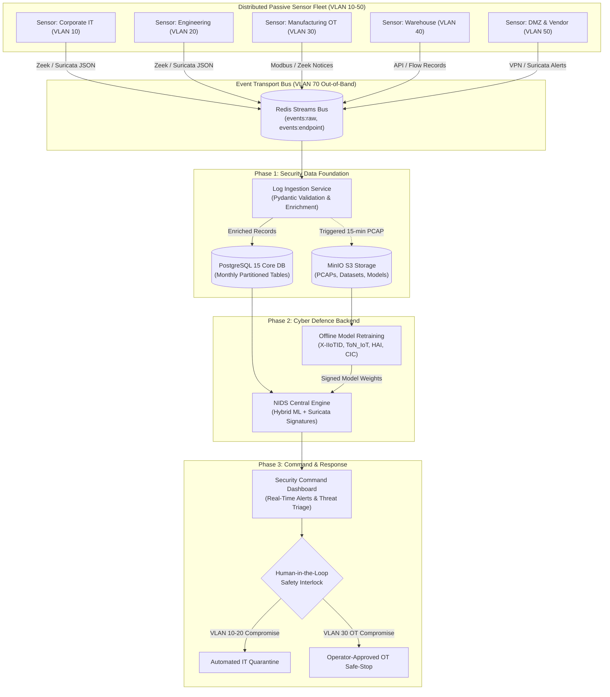

# VaultX — Manufacturing-Aware Hybrid NIDS for Indian Electronics Manufacturing MSMEs

[](.github/workflows/ci.yml)
[](https://www.python.org/downloads/)
[](LICENSE)
[](docker/docker-compose.yml)
[](database/schema/)
[](telemetry/zeek/)
[](telemetry/suricata/)

---

## 1. Project Overview

**VaultX** is an open-source, manufacturing-aware Network Intrusion Detection System (NIDS) specifically engineered to safeguard mid-sized Indian electronics manufacturing enterprises. Built around the reference environment of **Bharat Electronics Components Pvt. Ltd. (BECPL)**—a ₹35–60 Crore electronics manufacturing MSME in Bhosari MIDC, Pune—VaultX bridges the gap between commodity enterprise IT security and mission-critical shopfloor Operational Technology (OT).

### 1.1 The Problem It Solves
Electronics manufacturing MSMEs in India are experiencing rapid digital transformation driven by the "Make in India" initiative and Production-Linked Incentive (PLI) schemes. However, their cybersecurity posture suffers from severe systemic vulnerabilities:
- **Asymmetric Threat Landscape:** As Tier-2 suppliers to automotive and consumer electronics OEMs, MSMEs are prime targets for supply chain pivoting, ransomware, and intellectual property theft.
- **Lean Operational Capacity:** Most MSMEs operate with a total IT team of only 3–4 engineers who lack specialized OT security or dedicated 24/7 Security Operations Center (SOC) resources.
- **Unacceptable Cost of Downtime:** Production lines (SMT pick-and-place machines, wave soldering, automated optical inspection) operate on rigid schedules. An unwarranted automated network disconnect can cause thermal damage, defective PCB batches, and millions of rupees in losses.
- **Enterprise Tool Mismatch:** Conventional commercial SIEM and NIDS tools are either cost-prohibitive, bandwidth-heavy, cloud-dependent, blind to industrial protocols (Modbus TCP, OPC-UA), or prone to reckless automated isolation.

VaultX provides a lightweight, resilient, and deterministic cyber defense fabric tailored for lean engineering teams.

---

## 2. Three-Phase Project Architecture

VaultX is developed across three sequential phases:
- **Phase 1: Infrastructure Build, Digital Twin & Data Foundation** *(Current Phase)*  
  Containerized simulation of BECPL's 7-VLAN infrastructure, PostgreSQL time-series schema, Redis Streams event transport, distributed passive sensor agents, synthetic traffic generators, and multi-dataset harmonisation.
- **Phase 2: Centralised Cyber Defence Backend**  
  Machine learning-based intrusion detection engine, hybrid statistical/signature correlation, MITRE ATT&CK for ICS mapping, and offline model retraining pipelines.
- **Phase 3: Security Command Dashboard**  
  Web-based operational command console, real-time threat map, alert triage console, and policy-governed Human-in-the-Loop (HITL) isolation controls.



---

## 3. Key Architectural Principles

VaultX is built upon **five foundational security design decisions**:

1. **Distributed Passive Sensors (Zero Inline Footprint):**  
   Sensors monitor traffic passively via switch SPAN/mirror ports or physical hardware taps. Sensors do not bind IP addresses to monitoring interfaces and do not route traffic, preventing single points of failure, latency injection, or physical disruption to deterministic shopfloor PLCs.
2. **Multi-Source Identity Classification Beyond Network Packets:**  
   Packets alone can be spoofed or obfuscated by NAT and TLS. VaultX correlates network flows with endpoint telemetry (Sysmon/auditd process trees) and authentication logs (LDAP/VPN) to accurately classify workloads into 7 distinct identities: `HUMAN_USER`, `SERVICE_ACCOUNT`, `AUTOMATION_WORKLOAD`, `AI_AGENT`, `INDUSTRIAL_DEVICE`, `THIRD_PARTY_IDENTITY`, or `UNKNOWN_IDENTITY`.
3. **Bounded, Configurable Data Retention (Zero PCAP Bloat):**  
   Continuous raw packet capture is unsustainable for MSMEs. VaultX maintains a 15-minute rolling circular buffer, committing full PCAPs to MinIO object storage only upon an anomaly trigger. Time-series flow records use PostgreSQL declarative monthly partitioning with automated pruning.
4. **Offline Model Retraining (Anti-Poisoning Architecture):**  
   Real-time detection models are never retrained directly on live production streaming events, preventing adversarial poisoning and concept drift distortion. Model retraining occurs out-of-band using curated, cryptographically validated datasets.
5. **Policy-Driven OT Isolation (Mandatory Human-in-the-Loop):**  
   While compromised IT laptops can be autonomously quarantined, industrial PLCs and SMT line controllers require mandatory Human-in-the-Loop (HITL) authorization before any isolation action can be executed, safeguarding physical safety and equipment integrity.

*For detailed architectural specifications, read [docs/security_principles.md](docs/security_principles.md).*

---

## 4. Phase 1 Quick-Start Guide

### 4.1 Prerequisites
- Docker Engine 24.0+ and Docker Compose v2.20+
- Python 3.11+
- Git

### 4.2 Installation & Startup

```bash
# 1. Clone repository
git clone https://github.com/becpl/vaultx.git
cd vaultx

# 2. Setup environment variables
cp docker/.env.example docker/.env

# 3. Start Security & Database Stack
docker compose -f docker/compose/security.yml up -d

# 4. Initialize Database Schemas
docker exec -i vaultx-security-db psql -U vaultx_user -d vaultx < database/schema/01_core_tables.sql
docker exec -i vaultx-security-db psql -U vaultx_user -d vaultx < database/schema/02_time_series_tables.sql
docker exec -i vaultx-security-db psql -U vaultx_user -d vaultx < database/schema/03_incident_tables.sql
docker exec -i vaultx-security-db psql -U vaultx_user -d vaultx < database/schema/04_indexes.sql

# 5. Launch Full Manufacturing Digital Twin Simulation
docker compose -f docker/docker-compose.yml up -d
```

### 4.3 Key Service Endpoints

| Service | Subsystem / Role | Host URL / Port | Default Credentials |
|---|---|---|---|
| **VaultX NIDS Central API** | Central Orchestrator | [http://localhost:8070/health](http://localhost:8070/health) | N/A (Phase 1 placeholder) |
| **MinIO Console** | Security Object Storage | [http://localhost:9001](http://localhost:9001) | `minio` / `minio123` |
| **Node-RED HMI** | Shopfloor SCADA / Operator UI | [http://localhost:1880](http://localhost:1880) | Anonymous (Lab mode) |
| **Gitea** | Engineering Firmware Repository | [http://localhost:3000](http://localhost:3000) | Setup wizard on 1st run |
| **Jenkins CI** | Firmware Build Server | [http://localhost:8080](http://localhost:8080) | Initial admin token in container log |
| **OpenPLC Modbus TCP** | SMT Line PLC Controller | `localhost:5020` / `502` | Unit ID: 1 |

*For complete operational instructions, see [docs/deployment_guide.md](docs/deployment_guide.md).*

---

## 5. Repository Structure

```
vaultx/
├── .github/
│   └── workflows/ci.yml         # Automated GitHub Actions CI workflow (linting, schema validation)
├── backend/
│   └── ingestion/               # Log ingestion service, event schema (Pydantic), Zeek & Suricata parsers
├── database/
│   ├── schema/                  # PostgreSQL 15 DDL: 01_core, 02_time_series, 03_incidents, 04_indexes
│   └── init/                    # Container entrypoint initialization scripts
├── docker/
│   ├── docker-compose.yml       # Top-level multi-VLAN digital twin orchestrator
│   ├── .env.example             # Template environment variables
│   ├── compose/                 # Segment compose manifests: corporate, engineering, ot, warehouse, dmz, security, cloud
│   └── scripts/                 # Mock MES API, Modbus TCP server, WMS simulators
├── docs/
│   ├── architecture_overview.md # System context and multi-phase roadmap
│   ├── data_foundation.md       # Database schema, partitioning, Redis Streams & MinIO specification
│   ├── dataset_guide.md         # Multi-dataset benchmark acquisition, harmonisation & evaluation guide
│   ├── deployment_guide.md      # Step-by-step setup, verification checklists & troubleshooting
│   ├── hardware_requirements.md # Lab prototype sizing & production hardware roadmap
│   ├── network_topology.md      # Detailed 7-VLAN architecture and IP allocation tables
│   ├── organisation_profile.md  # Profile of Bharat Electronics Components Pvt. Ltd. (BECPL)
│   ├── phase1_deliverables.md   # Complete deliverables checklist & verification matrix
│   ├── security_principles.md   # The 5 foundational architectural decisions explained in depth
│   └── vendor_access_policy.md  # Security policy for third-party remote maintenance & logistics
├── infra/
│   └── topology/                # assets.json, communication_matrix.json, firewall_rules.json
├── scenarios/                   # Documentation and playbooks for 7 targeted threat scenarios
├── telemetry/
│   ├── dataset_registry/        # datasets.json metadata and acquisition guides
│   ├── endpoint/                # Sysmon XML configuration and Linux auditd rules
│   ├── sensors/                 # Sensor agent daemon and YAML configurations
│   ├── suricata/                # Suricata configuration and custom detection rules
│   ├── third_party/             # Simulated VPN, cloud audit, and API gateway access logs
│   ├── traffic_simulation/      # Normal traffic generator and attack scenario injector
│   └── zeek/                    # Zeek configs and custom BECPL protocol enrichment scripts
├── CONTRIBUTING.md              # Coding standards, branch naming, PR checklist & security disclosures
├── LICENSE                      # MIT Open-Source License
└── README.md                    # Project overview & architectural guide
```

---

## 6. Dataset Acknowledgements & Academic Citations

VaultX incorporates training methodologies, feature schemas, and validation paradigms from the following benchmark datasets:
- **X-IIoTID:** Alhawawreh et al., *X-IIoTID: A New Dataset for Industrial IoT Security*, UNSW Sydney.
- **ToN_IoT:** Alsaedi et al., *TON_IoT: A New Dataset for Heterogeneous Internet of Things and Industrial Internet of Things Networks*, UNSW Canberra Cyber.
- **CSE-CIC-IDS2018 & CIC-IDS2017:** Sharafaldin et al., Canadian Institute for Cybersecurity (CIC) & Communications Security Establishment (CSE), University of New Brunswick.
- **HAI 22.04 / 23.05:** Shin et al., *Hardware-in-the-Loop Augmented ICS (HAI) Testbed*, ETRI & Affiliated Institute of ETRI, South Korea.
- **UNSW-NB15:** Moustafa & Slay, *The evaluation of Network Anomaly Detection Systems: The UNSW-NB15 dataset*, IEEE.

*For instructions on acquiring and preprocessing these datasets, refer to [docs/dataset_guide.md](docs/dataset_guide.md).*

---

## 7. Contributing & Governance

Contributions to VaultX are welcome. Please read [CONTRIBUTING.md](CONTRIBUTING.md) for details on code style (PEP 8, Flake8), branch naming conventions (`feature/`, `fix/`, `docs/`), PR review processes, and our responsible security disclosure policy.

---

## 8. License

This project is licensed under the **MIT License** — see the [LICENSE](LICENSE) file for details.  
Copyright (c) 2026 Bharat Electronics Components Pvt. Ltd. (BECPL) / VaultX Contributors.
