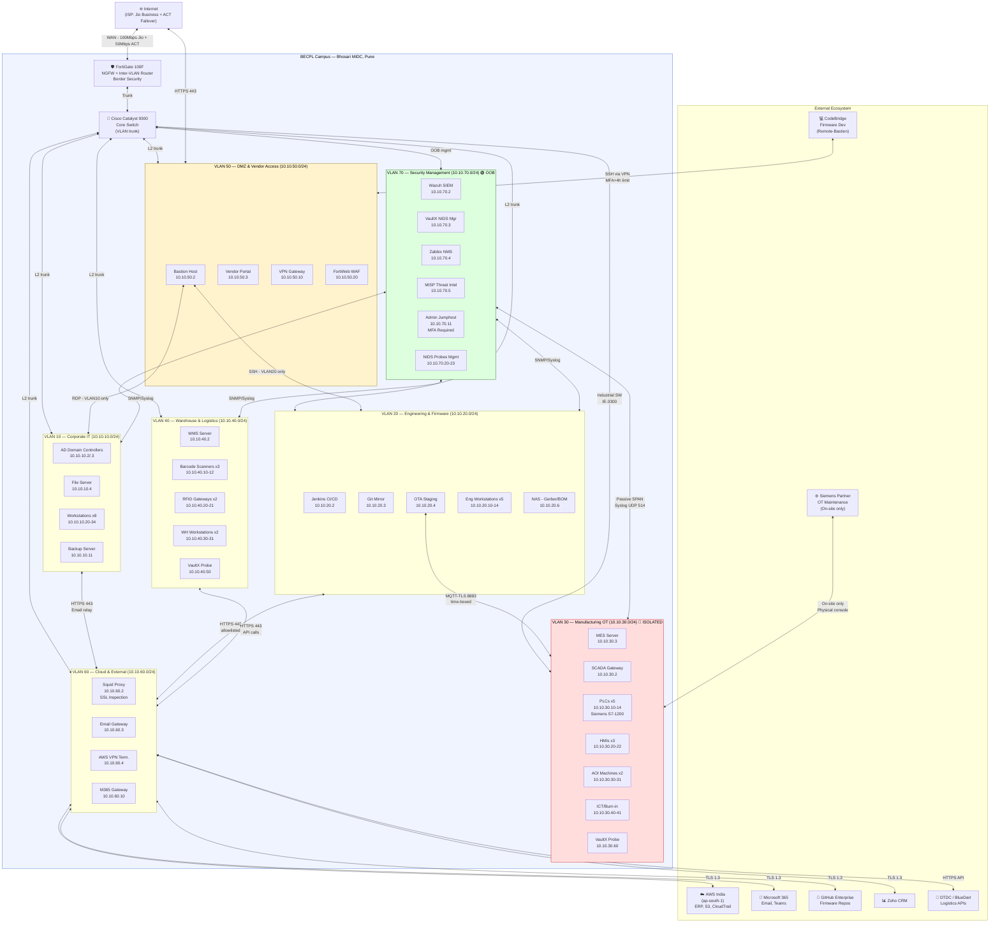
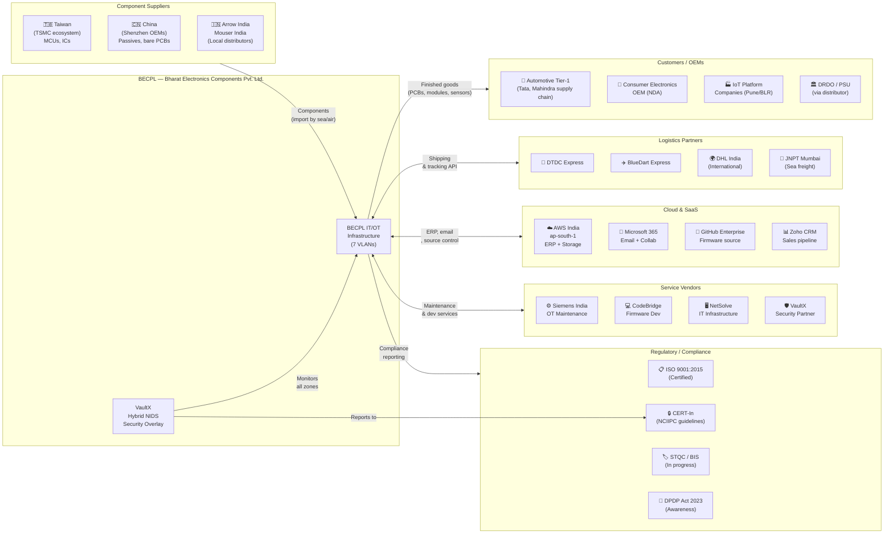

# Architecture Overview — VaultX Manufacturing-Aware Hybrid NIDS

> **Document version:** 1.0  
> **Classification:** Internal – Restricted  
> **Last updated:** 2026-11-17  
> **Owner:** Infrastructure Architect, VaultX NIDS Project  
> **Audience:** VaultX Project Stakeholders, BECPL IT Team, Security Partner

---

## 1. Executive Summary

**VaultX** is a Manufacturing-Aware Hybrid Network Intrusion Detection System (NIDS) designed specifically for Bharat Electronics Components Pvt. Ltd. (BECPL), a Pune-based MSME electronics manufacturer. The system provides unified visibility and threat detection across BECPL's IT, Engineering, Operational Technology (OT), and Logistics network zones.

VaultX is delivered in three phases over 12 months, progressing from passive visibility and baselining, through active threat detection and alerting, to automated response and regulatory compliance reporting.

**Key Design Principles:**
- **IT/OT Separation Preserved** — All detection is passive in OT zones; no active scanning or response in VLAN 30
- **Zone-Based Trust Architecture** — 7 VLANs with explicit deny-all defaults and minimal explicit allows
- **Hybrid Detection** — Combines signature-based (Suricata rules) and ML-based anomaly detection (behavioural baselines)
- **Indian Manufacturing Context** — Tuned for Modbus, EtherNet/IP, MQTT, and common embedded firmware protocols
- **Minimal Footprint** — NIDS probes are passive; no inline blocking in OT (avoid production impact)

---

## 2. Three-Phase Delivery Architecture

### Phase 1 — Visibility & Baseline (Months 1–3)

**Goal:** Establish full network visibility, discover all assets, and build behavioural baselines.

**Key Deliverables:**
- Passive NIDS probe deployment at all 4 production SPAN points (SP-01 through SP-04)
- VaultX Asset Discovery Engine — auto-populates `assets.json` from passive traffic
- Protocol fingerprinting for OT protocols (Modbus, EtherNet/IP, MQTT, S7comm)
- 90-day baseline capture (traffic volumes, communication peers, protocol patterns per VLAN)
- VaultX Management Console deployment on VLAN 70 (SEC-NIDS-MGR01)
- SIEM integration: Wazuh ingest from all probes

**Infrastructure Added (Phase 1):**
- 4× VaultX Probe appliances (OT-NIDS-PROBE01, WH-NIDS-PROBE01, SEC-PROBE-CORP, SEC-PROBE-ENG)
- 1× VaultX Management Server (SEC-NIDS-MGR01)
- SPAN port configuration on Cisco Catalyst 9300, Cisco IE-3300

---

### Phase 2 — Threat Detection (Months 4–7)

**Goal:** Activate signature + anomaly detection; build alert pipeline.

**Key Deliverables:**
- Suricata IDS ruleset activation (Emerging Threats + custom OT rules)
- ML anomaly detection model training on Phase 1 baseline
- Modbus/DNP3 command validation engine
- Alert routing: Probe → SIEM (Wazuh) → PagerDuty / SMS → IT Manager
- Threat Intelligence integration: MISP feed ingestion (SEC-THREATINTEL01)
- VaultX dashboard: Live topology map with alert overlay
- Identity-aware correlation: map network flows to `identity_classification` from asset registry

**New Detection Capabilities:**
- OT protocol anomaly (unexpected Modbus function codes, coil writes outside business hours)
- Lateral movement detection (inter-VLAN unexpected paths)
- Vendor session anomaly (access outside approved windows, non-standard ports)
- Cloud exfiltration heuristics (large outbound to unexpected destinations via VLAN 60)

---

### Phase 3 — Response & Hardening (Months 8–12)

**Goal:** Automated response playbooks, OT policy enforcement, compliance reporting.

**Key Deliverables:**
- FortiGate integration: automated firewall rule push on confirmed threats (IT zones only)
- OT incident playbook: alert → human review → physical isolation (no automated OT blocking)
- BECPL Cybersecurity Incident Response Plan (IRP) document
- ISO 9001 / IEC 62443 compliance reporting module
- CERT-In 6-hour notification workflow
- Annual red team exercise plan
- VaultX dashboard v2: compliance posture view, trend analytics

---

## 3. Network Architecture Diagram



---

## 4. System Context Diagram — BECPL External Relationships



---

## 5. Security Architecture Principles

### 5.1 Defense-in-Depth Stack

| Layer | Control |
|---|---|
| **Perimeter** | FortiGate 100F NGFW with IPS, SSL inspection, geo-blocking |
| **Network Segmentation** | 7 VLANs with explicit inter-VLAN firewall policy |
| **OT Isolation** | VLAN 30 default deny-all; physical air-gap for vendor maintenance |
| **Detection** | VaultX hybrid NIDS (signature + ML anomaly) across 4 SPAN points |
| **Identity** | Active Directory + MFA (Duo/Authenticator) rollout; PAM for privileged access |
| **Endpoint** | Windows Defender ATP on IT endpoints; EDR rollout in progress |
| **Cloud** | AWS CloudTrail, IAM least-privilege, S3 bucket policies, GuardDuty |
| **Response** | SIEM alert pipeline → IT Manager → FortiGate automated response (IT only) |
| **Logging** | Centralised on VLAN 70 (Wazuh + OpenSearch); 1-year retention |

### 5.2 Trust Boundaries

```
HIGH TRUST (internal, authenticated)
│  VLAN 70 — Security Management (admin + MFA only)
│  VLAN 20 — Engineering (domain auth, allowlisted internet)
│  VLAN 10 — Corporate IT (domain auth)
│
MEDIUM TRUST (controlled, monitored)
│  VLAN 40 — Warehouse (domain auth, limited scope)
│  VLAN 30 — Manufacturing OT (isolated, no external auth)
│
LOW TRUST (controlled access, session-limited)
│  VLAN 50 — DMZ/Vendor (MFA + bastion + session recording)
│  VLAN 60 — Cloud/External (proxy only, SSL inspected)
│
ZERO TRUST (untrusted)
   Internet / External
```

### 5.3 OT-Specific Security Decisions

| Decision | Rationale |
|---|---|
| **No inline blocking in VLAN 30** | Risk of production disruption (false positives stopping PLCs = manufacturing halt) |
| **Passive SPAN taps only in OT** | No active probes that generate traffic to OT devices |
| **Separate industrial switch (IE-3300)** | Supports OT protocols and power redundancy; isolates from IT switching fabric |
| **On-site-only OT vendor access** | Remote OT access is unacceptably high risk; Siemens engineers must physically attend |
| **Modbus/EtherNet/IP deep inspection** | VaultX probe performs protocol-aware parsing; alerts on function code anomalies |
| **OT asset patching freeze** | PLC firmware only updated during scheduled maintenance windows (quarterly) |

---

## 6. Data Flow Summary

| Flow | Source | Destination | Protocol | Inspection |
|---|---|---|---|---|
| Corporate internet | VLAN 10 | Internet | HTTPS via VLAN 60 proxy | SSL inspection (FortiGate) |
| OT telemetry → SIEM | VLAN 30 | VLAN 70 | Syslog UDP 514 | VaultX probe passively monitors |
| Firmware OTA push | VLAN 20 (OTA server) | VLAN 30 (PLCs) | MQTT-TLS 8883 | Allowlisted flow; VaultX alert if off-schedule |
| Vendor remote session | Internet → VLAN 50 | VLAN 20 or 10 | SSH/RDP via bastion | Full session recording |
| ERP cloud sync | VLAN 10/60 | AWS ap-south-1 | HTTPS + IPSec VPN | CloudTrail + VaultX cloud module |
| Logistics API | VLAN 40/60 | DTDC/BlueDart | HTTPS REST API | Proxy allowlist; API key auth |
| Threat intel updates | VLAN 70 (MISP) | Internet (via proxy) | HTTPS | Allowlisted feeds only |

---

## 7. VaultX Component Architecture

```
┌─────────────────────────────────────────────────────────────────┐
│                    VLAN 70 — Security Management                 │
│  ┌──────────────────┐   ┌────────────────┐   ┌───────────────┐  │
│  │  VaultX NIDS Mgr  │   │  Wazuh SIEM    │   │  MISP TI Feed │  │
│  │  (SEC-NIDS-MGR01) │◄──│  (SEC-SIEM01)  │◄──│  Aggregator   │  │
│  │  - Probe mgmt     │   │  - Alert mgmt  │   │  (SEC-TI-01)  │  │
│  │  - Topology map   │   │  - Correlation │   └───────────────┘  │
│  │  - Rule engine    │   │  - Dashboard   │                       │
│  └──────────────────┘   └────────────────┘                       │
└─────────────────────────────────────────────────────────────────┘
         ▲                      ▲                    ▲
         │ Probe telemetry      │ Syslog/SNMP        │
    ┌────┴──────┐          ┌────┴──────┐        ┌────┴──────┐
    │  Probe    │          │  Probe    │        │  Probe    │
    │  OT SPAN  │          │  Corp SPAN│        │  WH SPAN  │
    │ (VLAN 30) │          │ (VLAN 10) │        │ (VLAN 40) │
    └───────────┘          └───────────┘        └───────────┘
         │                      │                    │
    [SMT PLCs]            [Corp Workstations]   [WMS/Scanners]
    [HMIs/AOI]            [Servers/Printers]    [RFID Gateways]
```

---

## 8. Compliance Mapping

| Requirement | Framework | VaultX Control |
|---|---|---|
| Continuous network monitoring | NIST CSF DE.CM-1 | NIDS probes + SIEM |
| OT network segmentation | IEC 62443-3-3 SR 5.1 | VLAN 30 isolation + FortiGate policy |
| Audit log integrity | ISO 27001 A.12.4 | Centralised log collection VLAN 70, tamper-evident |
| Incident detection & response | CERT-In 2022 directions | VaultX alert pipeline + IRP (Phase 3) |
| Vendor access controls | ISO 27001 A.15 | Vendor Access Policy (this project) |
| Vulnerability management | NIST CSF ID.RA-1 | OpenVAS (SEC-VULN-SCAN01), quarterly scan |

---

*Document prepared by: VaultX Infrastructure Architect*  
*Review cycle: Quarterly or upon major architecture change*
