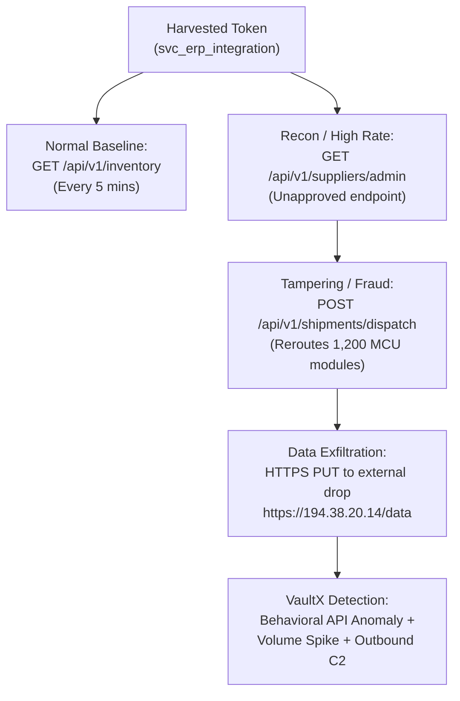

# Scenario 02: Service Credential Misuse (SCN-002)

---

## 1. Scenario Overview

| Attribute | Specification |
|:---|:---|
| **Scenario ID** | SCN-002 |
| **Scenario Name** | Service Credential Misuse & API Abuse |
| **Severity Level** | **High** |
| **Target Enterprise** | Bharat Electronics Components Pvt. Ltd. (BECPL), Pune |
| **Target Subsystems** | ERP Application Server, Warehouse Management System (WMS API), Cloud Egress |
| **Compromised Account**| `svc_erp_integration` (M2M Automation Workload Identity) |
| **Source Hosts** | ERP Server (`10.10.10.10` / `10.10.60.10`), Rogue internal host (`10.10.10.35`) |
| **Destination Hosts** | WMS Server (`WH-WMS-SVR01` / `10.10.40.2`), Cloud Logistics (`10.10.60.11`), External C2 (`194.38.20.14`) |
| **Simulation Duration** | 30 minutes |
| **Total Generated Events** | 32 labelled events |
| **OT Safety Criticality** | **Low** (Operational logistics impact, no direct industrial PLC control) |

---

## 2. Threat Actor Profile & Attack Vector

### 2.1 Threat Actor Profile
- **Adversary Type:** Malicious Insider (disgruntled logistics operator or former contractor) or External Actor possessing stolen hardcoded API tokens harvested from an unencrypted configuration file or GitLab repo commit.
- **Objective:** Manipulate finished goods dispatch records, alter delivery addresses for high-value component consignments (automotive grade microcontrollers / IoT smart meter assemblies), and exfiltrate supplier pricing and inventory data to an external staging server.

### 2.2 Attack Progression Flow

---

## 3. Baseline vs. Anomalous Behavioral Profiling

### 3.1 Normal Baseline Profile (`svc_erp_integration`)
- **Originating Host:** `10.10.10.10` (Corporate ERP Integration Daemon).
- **Target Host:** `WH-WMS-SVR01` (`10.10.40.2:8443`).
- **HTTP Methods Permitted:** `GET` strictly.
- **API Endpoints:** `/api/v1/inventory/summary`, `/api/v1/stock/status`.
- **Frequency:** Exactly 1 request every 300 seconds (5 minutes) ± 5 seconds jitter.
- **User-Agent:** `BECPL-ERP-Connector/2.1 (Linux x86_64; Go-http-client/1.1)`.
- **Payload Size:** Average 1.2 KB request, 15–20 KB response.
- **External Connections:** 0 connections outside `10.10.0.0/16`.

### 3.2 Anomalous Behavior Observed
1. **Method Anomaly:** Invocations of `POST`, `PUT`, and `DELETE`.
2. **Endpoint Anomaly:** Queries to privileged endpoints `/api/v1/suppliers/admin`, `/api/v1/finance/vendor-invoices`, and `/api/v1/shipments/dispatch`.
3. **Volume Anomaly:** Request burst of over 120 requests in 90 seconds.
4. **Identity & Source Replay:** The Bearer JWT token associated with `svc_erp_integration` is submitted from an unapproved IP (`10.10.10.35` — finance workstation).
5. **Unauthorized Egress:** Direct HTTPS connection initiated from the compromised node to external IP `194.38.20.14` on TCP port 8443.

---

## 4. Timeline of Simulation Events

| Timestamp (T+) | Event ID | Source Entity | Target Entity | Action / Protocol | Label | Detailed Description |
|:---|:---|:---|:---|:---|:---:|:---|
| T+00:00 | EVT-02-01 | 10.10.10.10:41200 | 10.10.40.2:8443 | GET /api/v1/inventory | Benign | Standard baseline ERP inventory check. Token valid. Status 200 OK. |
| T+05:00 | EVT-02-02 | 10.10.10.10:41208 | 10.10.40.2:8443 | GET /api/v1/inventory | Benign | Standard baseline ERP inventory check. Status 200 OK. |
| T+07:15 | EVT-02-03 | 10.10.10.35:55201 | 10.10.40.2:8443 | POST /api/v1/auth/validate | Malicious | Token replay: Stolen Bearer token validated from unauthorized workstation `CORP-WS-005`. |
| T+08:00 | EVT-02-04 | 10.10.10.35:55204 | 10.10.40.2:8443 | GET /api/v1/suppliers/admin | Malicious | Endpoint violation: Service account attempts retrieval of supplier database and banking details. |
| T+08:02 | EVT-02-05 | 10.10.40.2:8443 | 10.10.10.35:55204 | HTTP 200 OK (3.4MB) | Malicious | Supplier catalog and invoice history exported. |
| T+12:30 | EVT-02-06 | 10.10.10.35:55220 | 10.10.40.2:8443 | POST /api/v1/shipments/dispatch | Malicious | Parameter manipulation: Creation of rogue shipment dispatch order `#SHP-2026-9901` rerouting goods. |
| T+12:32 | EVT-02-07 | 10.10.40.2:8443 | 10.10.10.35:55220 | HTTP 201 Created | Malicious | Fraudulent shipment created in WMS system. |
| T+15:00 | EVT-02-08 | 10.10.10.35:58900 | 194.38.20.14:8443 | TLS 1.3 / HTTPS PUT | Malicious | External C2 exfiltration: Data upload of 3.4 MB to unclassified foreign IP in Romania. |
| T+15:30 | EVT-02-09 | 10.10.70.3 | 10.10.40.2:8443 | API Revoke Call | Mitigation | VaultX triggers immediate invalidation of token `svc_erp_integration` via WMS auth endpoint. |
| T+15:32 | EVT-02-10 | 10.10.70.3 | 10.10.10.1 | Firewall Quarantine | Mitigation | FortiGate isolates `10.10.10.35` into Quarantine VLAN. |

---

## 5. MITRE ATT&CK Mapping

| Tactic | Technique ID | Technique Name | Context in BECPL Ecosystem |
|:---|:---|:---|:---|
| **Defense Evasion** | `T1078.004` | Valid Accounts: Cloud / Workload Accounts | Misuse of legit service token `svc_erp_integration` to avoid detection. |
| **Execution** | `T1059` | Command and Scripting Interpreter | Python script executing automated API interactions. |
| **Exfiltration** | `T1041` | Exfiltration Over C2 Channel | Supplier database dumped directly over HTTPS to rogue remote IP. |
| **Impact** | `T1565.001` | Data Manipulation: Stored Data Manipulation | Altering shipping manifests and delivery routes in WMS database. |

---

## 6. Detection Logic & Response Plan

### 6.1 VaultX Detection Features
- **Token Source IP Binding:** Alert triggered when JWT bearer token signed for `10.10.10.10` appears in requests originating from `10.10.10.35`.
- **HTTP Method Blacklist:** `svc_erp_integration` has strict method allowlist `['GET']`. Any `POST` or `DELETE` generates instant Level-3 alert.
- **High-Velocity Egress Anomaly:** Workstation `10.10.10.35` initiating outbound encrypted connections to rare ASN without matching DNS lookup in corporate resolver.

### 6.2 Containment
1. Revoke OAuth token secret in Redis cache.
2. Signal WMS to place a temporary hold on shipment batch `#SHP-2026-9901`.
3. Quarantine IP `10.10.10.35`.
